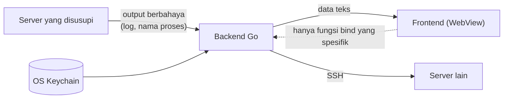
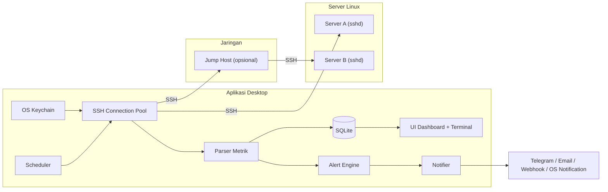
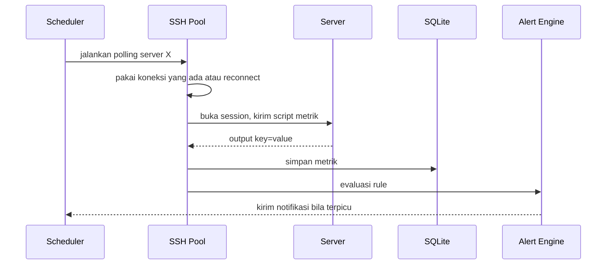

# PRD: Aplikasi Desktop Monitoring Server via SSH

| Item | Nilai |
|---|---|
| Nama kerja | ServerWatch (placeholder) |
| Versi dokumen | 0.4 (draft) |
| Tanggal | 27 Oktober 2026 |
| Status | Menunggu review |
| Perubahan dari 0.1 | Koneksi hanya lewat SSH (agentless). Agent dihapus dari cakupan. |
| Perubahan dari 0.2 | Tambah bagian 6.1 Keamanan Aplikasi Desktop (SEC-01 sampai SEC-14) dan risiko terkait. |
| Perubahan dari 0.3 | Tambah spesifikasi Monitoring Database (MySQL/MariaDB, PostgreSQL, Redis) dan Engine Backup Otomatis / Terjadwal berbasis SSH agentless (FR-35 sampai FR-43, SEC-15 sampai SEC-18). |

## 1. Latar Belakang

Admin dan developer yang mengelola beberapa server (VPS, on-premise, atau VM) biasanya mengecek kondisi server dengan SSH satu per satu, lalu menjalankan `htop`, `df -h`, atau `systemctl status`. Cara ini lambat dan tidak memberi peringatan ketika sesuatu rusak.

Solusi seperti Grafana + Prometheus atau Zabbix butuh server tambahan dan agent yang harus dipasang di setiap mesin. Banyak tim kecil tidak mau atau tidak boleh memasang software tambahan di server produksi.

Aplikasi ini memakai akses yang sudah dimiliki admin, yaitu SSH. Admin cukup memasukkan host dan kredensial SSH, lalu aplikasi desktop membaca metrik server secara berkala tanpa memasang apa pun di server.

## 2. Tujuan

1. Admin bisa melihat status semua server dalam satu dashboard tanpa membuka terminal.
2. Tidak ada instalasi di sisi server. Syaratnya hanya SSH aktif dan user yang bisa login.
3. Admin mendapat notifikasi ketika metrik melewati batas (CPU, RAM, disk, service mati, website down).
4. Menambahkan satu server selesai dalam waktu kurang dari 2 menit, termasuk import dari `~/.ssh/config`.
5. Data historis tersimpan lokal agar admin bisa melihat tren dan penyebab insiden.

### Di luar cakupan (v1)

- Agent yang dipasang di server.
- Server tanpa akses SSH.
- Monitoring Kubernetes tingkat cluster.
- Multi-user dengan role dan login terpusat.
- Versi web dan mobile.

## 3. Target Pengguna

| Persona | Kebutuhan utama |
|---|---|
| SysAdmin tim kecil (3 sampai 50 server Linux) | Satu layar untuk semua server, tidak perlu pasang agent |
| Developer / freelancer dengan beberapa VPS | Setup cepat pakai SSH key yang sudah ada |
| Tim yang server produksinya tidak boleh dipasangi software pihak ketiga | Monitoring tanpa mengubah server |

## 4. User Stories

| ID | Sebagai | Saya ingin | Agar |
|---|---|---|---|
| US-01 | Admin | menambahkan server dengan host, port, username, dan SSH key/password | server mulai dimonitor |
| US-02 | Admin | mengimpor host dari `~/.ssh/config` | tidak perlu mengetik ulang |
| US-03 | Admin | terhubung lewat jump host / bastion | bisa memonitor server di jaringan privat |
| US-04 | Admin | melihat daftar server beserta status (online, warning, down, gagal SSH) | tahu server mana yang bermasalah |
| US-05 | Admin | membuka detail satu server dan melihat grafik CPU, RAM, disk, network | menganalisis beban |
| US-06 | Admin | melihat proses dengan penggunaan resource terbesar | menemukan proses penyebab beban |
| US-07 | Admin | membuat aturan alert (misal CPU > 90% selama 5 menit) | diberi tahu sebelum server crash |
| US-08 | Admin | menerima notifikasi di desktop, Telegram, atau email | tetap tahu walau aplikasi diminimize |
| US-09 | Admin | membuka terminal SSH ke server langsung dari aplikasi | bisa langsung menangani masalah |
| US-10 | Admin | melihat log (journalctl, file di /var/log) dari aplikasi | mencari penyebab error tanpa pindah aplikasi |
| US-11 | Admin | melihat riwayat metrik 30 hari | mencari tren dan penyebab insiden |
| US-12 | Admin | mengelompokkan server dengan tag | dashboard tetap rapi |
| US-13 | Admin | melihat metrik database (koneksi aktif, QPS, slow query, ukuran DB) | memantau kesehatan database tanpa login DBMS manual |
| US-14 | Admin | memicu backup database on-demand dan menjadwalkan backup otomatis berkala | data terlindungi dari kehilangan tanpa setup script rumit di server |
| US-15 | Admin | mengatur retensi backup (rotasi) dan lokasi simpan (lokal/remote) | disk server tidak penuh dan ada salinan cadangan aman |

## 5. Kebutuhan Fungsional

### 5.1 Manajemen Server & Koneksi SSH
- FR-01: Tambah, edit, hapus server. Field: nama, host/IP, port (default 22), username, metode autentikasi, jump host, tag, catatan.
- FR-02: Metode autentikasi:
  - Private key (Ed25519, ECDSA, RSA), termasuk key dengan passphrase.
  - Password.
  - SSH agent (Pageant / OpenSSH agent di Windows, ssh-agent di macOS/Linux).
- FR-03: Dukungan jump host (ProxyJump), bisa bertingkat.
- FR-04: Import host dari `~/.ssh/config` (Host, HostName, User, Port, IdentityFile, ProxyJump).
- FR-05: Verifikasi host key. Saat koneksi pertama, tampilkan fingerprint untuk dikonfirmasi user. Jika host key berubah, blokir koneksi dan beri peringatan.
- FR-06: Tes koneksi sebelum menyimpan, sekaligus deteksi OS, distro, dan command yang tersedia.
- FR-07: Satu koneksi SSH persisten per server. Setiap polling membuka session (channel) baru di koneksi yang sama, bukan login ulang.
- FR-08: Reconnect otomatis dengan exponential backoff (5 detik, 10, 20, maksimal 5 menit) saat koneksi putus.
- FR-09: Batas koneksi paralel bisa diatur (default 20) agar laptop dan jaringan tidak terbebani saat memonitor banyak server.

### 5.2 Cara Pengambilan Metrik

Aplikasi menjalankan satu script shell per siklus polling, bukan banyak command terpisah, agar overhead SSH rendah. Output dikembalikan dalam format yang mudah di-parse (key=value atau JSON sederhana).

| Kategori | Sumber data (Linux) | Metrik |
|---|---|---|
| CPU | `/proc/stat`, `/proc/loadavg` | Usage total & per core (dihitung dari selisih dua sampel), load average |
| Memori | `/proc/meminfo` | Used, free, available, cached, swap |
| Disk | `df -P`, `/proc/diskstats` | Usage per partisi, inode, read/write throughput |
| Network | `/proc/net/dev` | Bandwidth in/out per interface |
| Sistem | `/proc/uptime`, `uname`, `/etc/os-release`, `who` | Uptime, kernel, distro, user login |
| Proses | `ps` | Top N proses berdasarkan CPU/RAM |
| Service | `systemctl is-active` | Status service yang dipilih user |
| Suhu (opsional) | `/sys/class/thermal` | Suhu CPU bila tersedia |

- FR-10: Interval polling bisa diatur per server (default 10 detik, minimal 5 detik).
- FR-11: Semua metrik dasar bisa dibaca oleh user biasa tanpa `sudo`.
- FR-12: Kompatibel dengan shell `sh` minimal (BusyBox di Alpine), tidak bergantung pada `bash`.
- FR-13: Jika command tertentu tidak tersedia, metrik itu ditandai "tidak didukung" tanpa membuat seluruh polling gagal.

### 5.3 Uptime Check (dari aplikasi)
- FR-14: Cek HTTP(S) status code & response time, TCP port, ICMP ping, dan masa berlaku sertifikat SSL.
- FR-15: Opsi menjalankan cek dari server via SSH (misal `curl` ke service internal yang tidak terbuka ke publik).

### 5.4 Dashboard & Visualisasi
- FR-16: Overview berupa grid/list semua server dengan indikator status: online, warning, critical, SSH gagal (beserta alasannya: timeout, auth gagal, host key berubah).
- FR-17: Halaman detail server dengan grafik real-time dan rentang waktu (1 jam, 24 jam, 7 hari, 30 hari).
- FR-18: Filter dan pencarian berdasarkan nama, tag, status.
- FR-19: Mode gelap dan terang.

### 5.5 Fitur Tambahan Berbasis SSH
- FR-20: Terminal SSH terintegrasi (tab per server) memakai koneksi yang sudah terautentikasi.
- FR-21: Log viewer: tail `journalctl -u <service>` atau file log dengan filter kata kunci.
- FR-22: Aksi cepat: restart service. Wajib konfirmasi, dan dimatikan secara default. Butuh izin sudo yang dikonfigurasi admin sendiri.

### 5.6 Alert & Notifikasi
- FR-23: Rule alert: metrik, operator, ambang batas, durasi, tingkat (warning/critical).
- FR-24: Alert khusus koneksi: server tidak bisa di-SSH selama N menit.
- FR-25: Channel notifikasi: notifikasi native OS, suara, Telegram bot, email (SMTP), webhook (Discord/Slack).
- FR-26: Alert dikirim saat terjadi dan saat pulih.
- FR-27: Mute/snooze per server atau per rule.
- FR-28: Log riwayat alert yang bisa difilter.

### 5.7 Penyimpanan & Laporan
- FR-29: Data metrik disimpan lokal di SQLite dengan retensi bisa diatur (default 30 hari).
- FR-30: Downsampling otomatis: data mentah 24 jam, rata-rata per menit 7 hari, rata-rata per jam 30 hari.
- FR-31: Export laporan uptime dan metrik ke CSV dan PDF.

### 5.8 Aplikasi Desktop
- FR-32: Berjalan di system tray, tetap memonitor saat jendela ditutup.
- FR-33: Opsi auto-start saat OS menyala.
- FR-34: Auto-update aplikasi.

### 5.9 Monitoring Database (Agentless via SSH)
- FR-35: Deteksi otomatis dan pengumpulan metrik database populer tanpa instalasi agent:
  - **MySQL / MariaDB**: Uptime, Threads Connected/Running, Max Connections, Queries Per Second (QPS), Slow Queries count, InnoDB Buffer Pool Hit Rate, Ukuran Database (MB/GB).
  - **PostgreSQL**: Uptime, Active & Idle Connections, Transactions Per Second (TPS), Cache Hit Ratio, Database Size, Deadlocks count.
  - **Redis**: Uptime, Connected Clients, Memory Used / Peak Memory, Hit Rate, Total Commands/sec, Evicted Keys.
- FR-36: Kredensial database (user, password, port, atau socket path) disimpan secara terisolasi di OS Keychain lokal (SEC-15). Mendukung autentikasi via UNIX domain socket (peer authentication) tanpa perlu menyimpan password.
- FR-37: Alert khusus database: koneksi mendekati batas (`threads_connected / max_connections > 85%`), lonjakan slow query, memory Redis melampaui ambang batas, atau database service down.

### 5.10 Engine Backup Otomatis & Terjadwal (Agentless via SSH)
- FR-38: **Backup On-Demand (Manual 1-Klik)**: Admin dapat memicu backup database kapan saja dari halaman detail database dengan konfirmasi cepat.
- FR-39: **Backup Otomatis Terjadwal (Scheduled Backup)**:
  - Konfigurasi jadwal fleksibel: Harian (pada jam sepi, misal 02:00), Mingguan (hari tertentu), atau interval berkala (setiap N jam).
  - Eksekusi dikelola oleh scheduler ServerWatch atau opsi mendaftarkan cron job aman di remote server.
- FR-40: **Mekanisme Dump & Kompresi Efisien**:
  - Memanfaatkan tool bawaan server yang teruji: `mysqldump` (wajib menggunakan `--single-transaction --quick` agar transaksi InnoDB tidak terkunci dan website tidak freeze), `pg_dump` (format custom/directory), `redis-cli --rdb`.
  - Kompresi stream langsung di server (`gzip` / `zstd`) untuk menghemat pemakaian storage dan bandwidth transfer.
  - Pembatasan beban I/O: eksekusi dump berjalan dengan prioritas rendah (`nice -n 19 ionice -c 3`) agar tidak mengganggu performa server produksi.
- FR-41: **Target Penyimpanan Fleksibel**:
  - **Target Remote**: Disimpan di direktori server target (contoh: `/var/backups/serverwatch/`).
  - **Target Lokal (Offsite)**: File backup di-stream langsung via SSH/SFTP ke penyimpanan lokal laptop admin (contoh: `C:\ServerWatch\Backups\...`), memberikan salinan cadangan sekunder di luar server.
- FR-42: **Kebijakan Retensi & Rotasi Otomatis**:
  - Rotasi berbasis hari: otomatis membersihkan file backup yang lebih tua dari N hari (default: simpan 7 hari terakhir).
  - Batas kuota: opsi membatasi total file cadangan (misal maksimal 10 file dump terakhir).
- FR-43: **Pre-flight Safety Check & Verifikasi Integritas**:
  - Pemeriksaan sisa kapasitas disk: proses dump otomatis dibatalkan jika sisa disk target < 15% atau kurang dari 2x estimasi ukuran database, guna mencegah risiko disk penuh yang dapat mematikan OS.
  - Verifikasi hasil dump: validasi exit code CLI, pengecekan ukuran file (> 0 byte), dan pengujian integritas file terkompresi (`gzip -t`).
- FR-44: **Riwayat Log & Notifikasi Status Backup**:
  - Riwayat backup tercatat persisten di database SQLite lokal (waktu eksekusi, database, ukuran file, durasi detik, status sukses/gagal, path file).
  - Notifikasi otomatis ke OS desktop, Telegram, atau Webhook jika proses backup berhasil atau gagal beserta detail kegagalannya.

## 6. Kebutuhan Non-Fungsional

| ID | Kategori | Kebutuhan |
|---|---|---|
| NFR-01 | Platform desktop | Windows 10+, macOS 12+, Ubuntu 22.04+ |
| NFR-02 | Server target (v1) | Linux dengan OpenSSH: Ubuntu, Debian, RHEL/Rocky/Alma, CentOS 7, Alpine |
| NFR-03 | Performa aplikasi | Idle < 150 MB RAM saat memonitor 20 server |
| NFR-04 | Beban di server | Satu siklus polling selesai < 200 ms CPU time di server, tanpa proses yang tertinggal |
| NFR-05 | Skala | Mampu memonitor minimal 100 server dengan interval 10 detik |
| NFR-06 | Keamanan | Password dan passphrase disimpan di OS keychain (Windows Credential Manager, macOS Keychain, libsecret). Private key cukup direferensikan lewat path, tidak disalin |
| NFR-07 | Keamanan | Host key diverifikasi setiap koneksi (FR-05). Tidak ada opsi "abaikan host key" secara global |
| NFR-08 | Keamanan | Dokumentasi menyarankan user khusus read-only (misal `monitor`) tanpa sudo |
| NFR-09 | Keandalan | Satu server yang lambat/timeout tidak menghambat polling server lain |
| NFR-10 | Bahasa | UI Bahasa Indonesia dan Inggris |

### 6.1 Keamanan Aplikasi Desktop

Aplikasi ini memegang akses SSH ke banyak server sekaligus. Jika aplikasi berhasil disusupi, penyerang bisa menjangkau semua server yang terdaftar. Karena itu, model ancaman utamanya adalah sebagai berikut.

> Penyerang yang menguasai satu server bisa mengatur output yang dibaca aplikasi (nama proses, isi log, hostname, nama service). Output itu tidak boleh bisa dipakai untuk menjalankan kode di aplikasi atau mengakses server lain.

Batas kepercayaan (trust boundary):
- Backend Go adalah satu-satunya komponen yang memegang kredensial dan membuka koneksi SSH.
- Frontend dianggap tidak tepercaya. Frontend hanya menerima data untuk ditampilkan dan hanya bisa meminta aksi lewat fungsi bind yang sempit.
- Semua output dari server dianggap input tidak tepercaya.

#### Penanganan data dari server

| ID | Kebutuhan |
|---|---|
| SEC-01 | Semua output server (log, nama proses, hostname, nama service, pesan error) ditampilkan sebagai teks biasa. Dilarang memakai `innerHTML`, `{@html}` (Svelte), atau `dangerouslySetInnerHTML` (React) untuk data ini |
| SEC-02 | Parser di backend Go memvalidasi tipe dan batas nilai (misal persentase 0 sampai 100) dan membatasi ukuran output per polling (default 1 MB). Output yang tidak valid dibuang dan dicatat |
| SEC-03 | Karakter kontrol dan escape sequence ANSI dibuang dari data yang tampil di luar terminal |

#### Batas antara frontend dan backend (Wails binding)

| ID | Kebutuhan |
|---|---|
| SEC-04 | Tidak ada fungsi bind yang menerima perintah shell bebas (misal `RunCommand(cmd string)`). Setiap aksi punya fungsi spesifik, seperti `GetMetrics(serverID)` atau `TailLog(serverID, service)` |
| SEC-05 | Setiap parameter dari frontend divalidasi di Go. Nama service dan path log dicocokkan dengan pola yang diizinkan (misal `^[a-zA-Z0-9@._-]+$`) dan dimasukkan ke command dengan quoting yang aman |
| SEC-06 | Aksi yang mengubah server (restart service, FR-22) mewajibkan dialog konfirmasi native OS dari sisi Go, bukan dialog HTML, sehingga script di frontend tidak bisa mengonfirmasi sendiri |
| SEC-07 | Terminal SSH (FR-20) hanya bisa dibuka ke server yang sudah terdaftar, berdasarkan ID server. Frontend tidak bisa menentukan host, port, atau kredensial |

#### Kredensial

| ID | Kebutuhan |
|---|---|
| SEC-08 | Password, passphrase, dan token notifikasi (bot Telegram, SMTP) hanya disimpan di OS keychain dan hanya dibaca oleh backend Go. Nilainya tidak pernah dikirim ke frontend, tidak ditulis ke log, dan tidak ikut dalam file export (FR-04) |
| SEC-09 | Kredensial yang sudah dibaca dari keychain tidak di-cache lebih lama dari yang dibutuhkan untuk membuka koneksi |

#### Konfigurasi WebView

| ID | Kebutuhan |
|---|---|
| SEC-10 | Semua aset frontend dibundel ke dalam aplikasi. Tidak ada pemuatan script, font, atau stylesheet dari CDN, dan tidak ada iframe ke situs luar |
| SEC-11 | Content Security Policy diterapkan, minimal: `default-src 'self'; script-src 'self'; object-src 'none'; frame-src 'none'; base-uri 'none'` |
| SEC-12 | Link eksternal (misal URL di hasil uptime check) dibuka di browser default lewat backend, bukan di dalam WebView. DevTools dimatikan di build rilis |

#### Rantai pasok dan distribusi

| ID | Kebutuhan |
|---|---|
| SEC-13 | Pipeline CI menjalankan `govulncheck` dan `npm audit` di setiap build. Build gagal jika ada celah berstatus high atau critical. Versi Wails dan dependency diperbarui minimal setiap bulan |
| SEC-14 | File installer dan executable ditandatangani (code signing di Windows, notarization di macOS). Paket auto-update (FR-34) diverifikasi tanda tangannya sebelum dipasang |

#### Keamanan Database & Engine Backup

| ID | Kebutuhan |
|---|---|
| SEC-15 | Password dan kredensial database disimpan secara terisolasi di OS Keychain. Saat menjalankan tool CLI (`mysqldump`, `pg_dump`), password tidak boleh dimasukkan sebagai argumen baris perintah `-p<password>` (karena terekspos di `ps aux`), melainkan dioper lewat environment variable (seperti `MYSQL_PWD` atau `PGPASSWORD`) atau file opsi temporer berizin `0600` |
| SEC-16 | Sanitasi nama database dan direktori: Semua input nama database, nama tabel, dan path target divalidasi ketat dengan regex `^[a-zA-Z0-9_-]+$` di backend Go untuk mencegah serangan *Command Injection* atau *Path Traversal* pada server target |
| SEC-17 | Whitelist parameter backup: Frontend dilarang mengirim arbitrary flag atau argumen shell bebas untuk backup. Backend Go secara kaku mem-whitelist flag aman yang diizinkan (misal `--single-transaction --quick` untuk MySQL dan `--no-owner --clean` untuk PostgreSQL) |
| SEC-18 | Disk Safety Guard: Backup otomatis wajib mengecek kapasitas disk sebelum mengeksekusi dump. Jika ruang bebas partisi target < 15% atau < 2x estimasi ukuran database, eksekusi otomatis dibatalkan dan alert `backup_aborted_disk_low` dikirimkan ke admin untuk mencegah server crash akibat disk penuh |

#### Verifikasi
- Uji XSS: server uji dengan nama proses, isi log, dan hostname yang berisi payload HTML/JavaScript. Hasil yang diharapkan: payload tampil sebagai teks dan tidak ada script yang jalan.
- Review kode untuk setiap fungsi bind baru, memakai daftar periksa SEC-04 sampai SEC-07.
- Pencarian otomatis di CI untuk `innerHTML`, `{@html}`, dan `dangerouslySetInnerHTML`.

## 7. Arsitektur Tingkat Tinggi

Alur satu siklus polling:

Catatan desain:
- Model pull lewat SSH berarti server tidak perlu membuka port baru selain port SSH yang sudah ada.
- CPU usage dihitung dari selisih dua pembacaan `/proc/stat`, jadi nilai pertama muncul setelah siklus kedua.
- Banyak server memakai fail2ban atau membatasi `MaxSessions`/`MaxStartups`. Koneksi persisten (FR-07) mencegah aplikasi dianggap brute force karena login berulang.
- Alert hanya terkirim selama aplikasi menyala. Ini batasan v1 yang perlu disampaikan ke pengguna. Mode headless (collector yang sama dijalankan sebagai service di satu mesin yang selalu menyala) masuk ke v1.0.

## 8. Rencana Rilis

| Fase | Isi | Perkiraan |
|---|---|---|
| MVP (v0.1) | Tambah server (key/password), host key verification, connection pool, metrik CPU/RAM/disk/network, dashboard overview + detail, SQLite, notifikasi OS | 5 sampai 7 minggu |
| v0.2 | Import `~/.ssh/config`, jump host, SSH agent, alert rule, Telegram & email, system tray | 4 minggu |
| v0.3 | Terminal terintegrasi, log viewer, status service, uptime check HTTP/TCP/ping, tag & filter | 4 minggu |
| v0.4 | Monitoring database (MySQL, PostgreSQL, Redis), engine backup manual & otomatis terjadwal (FR-35 sampai FR-44), rotasi retensi, streaming backup lokal | 4 minggu |
| v1.0 | Mode headless, export CSV/PDF, webhook, SSL expiry, auto-update, i18n | 4 minggu |
| Setelah v1 | Windows Server via OpenSSH + PowerShell, macOS/BSD | belum dijadwalkan |

Perkiraan waktu mengasumsikan 1 sampai 2 developer dan perlu disesuaikan dengan kapasitas tim.

Kebutuhan keamanan SEC-01 sampai SEC-13 wajib terpenuhi sejak MVP, karena aturan binding dan penanganan output sulit diperbaiki setelah banyak fitur dibangun. SEC-14 (code signing dan verifikasi update) wajib sebelum rilis publik pertama.

## 9. Metrik Keberhasilan

- Waktu dari instalasi sampai server pertama tampil di dashboard < 2 menit.
- Alert terkirim < 30 detik setelah kondisi terpenuhi (di luar durasi rule).
- Beban di server sesuai NFR-04, diukur dengan uji polling 10 detik selama 24 jam.
- Aplikasi stabil memonitor 100 server selama uji 7 hari tanpa crash atau kebocoran koneksi.

## 10. Risiko & Mitigasi

| Risiko | Dampak | Mitigasi |
|---|---|---|
| Kredensial SSH bocor dari laptop admin | Server dibobol | OS keychain, sarankan key + passphrase, user read-only tanpa sudo |
| Server yang disusupi mengirim output berbahaya (XSS) ke UI | Penyerang memakai aplikasi untuk menjangkau server lain | SEC-01 sampai SEC-07: output sebagai teks, fungsi bind spesifik, CSP, konfirmasi native |
| Dependency (Wails, library npm) memiliki celah | Aplikasi bisa dieksploitasi | SEC-13: `govulncheck`, `npm audit`, update rutin |
| Installer atau update dipalsukan | Malware terpasang di laptop admin | SEC-14: code signing dan verifikasi paket update |
| Aplikasi diblokir fail2ban / limit sesi | Monitoring putus | Koneksi persisten, backoff saat gagal autentikasi, berhenti mencoba setelah N kegagalan auth |
| Perbedaan distro dan versi tool (`ps`, `df`, BusyBox) | Parsing gagal | Prioritaskan `/proc` daripada output command, uji di semua distro NFR-02 |
| Laptop admin tidur/mati | Alert tidak terkirim | Mode headless di v1.0, peringatan jelas di UI |
| Host key berubah karena server di-reinstall | User bingung, koneksi terblokir | Pesan jelas dengan fingerprint lama dan baru, tombol terima setelah konfirmasi |
| Polling 100 server membebani laptop | Aplikasi lambat | Batas koneksi paralel (FR-09), jadwal polling disebar (jitter) |
| Proses dump database membebani I/O & mengunci transaksi produksi | Database freeze, website lambat | Flag `--single-transaction --quick` tanpa lock tabel, prioritas proses rendah (`nice`/`ionice`), jadwal di jam sepi (FR-40) |
| File backup menumpuk dan menghabiskan ruang disk server | Disk penuh, server crash | Retensi otomatis (hapus > N hari), kuota maksimal file, dan disk safety pre-flight check (SEC-18) |

## 11. Pertanyaan Terbuka

1. Apakah ada server Windows yang wajib dimonitor di v1?
2. Apakah fitur restart service (FR-22) perlu ada, atau aplikasi murni read-only?
3. Model bisnis: gratis, open-source, freemium, atau berbayar?
4. Apakah alert wajib berjalan 24 jam sejak MVP (berarti mode headless dimajukan)?

## 12. Rekomendasi Bahasa Pemrograman

Tanpa agent, semua logika ada di aplikasi desktop. Kebutuhan utamanya: library SSH yang matang (key, agent, jump host, known_hosts), mampu menangani ratusan koneksi bersamaan, dan UI grafik real-time lintas platform.

### Perbandingan

| Opsi | Library SSH | Kelebihan | Kekurangan |
|---|---|---|---|
| Go + Wails | `golang.org/x/crypto/ssh` (dikelola tim Go), `x/crypto/ssh/knownhosts`, `x/crypto/ssh/agent` | Goroutine cocok untuk ratusan koneksi paralel; library SSH lengkap termasuk agent dan known_hosts; binary tunggal | Ekosistem Wails lebih kecil dari Electron/Tauri; ProxyJump perlu dirangkai manual (sederhana) |
| Rust + Tauri | `russh` (async) atau `ssh2` (binding libssh2) | Paling hemat memori; aplikasi kecil | Kurva belajar curam; library SSH Rust belum sematang Go |
| C# .NET + Avalonia | SSH.NET | Tooling bagus, cocok untuk tim .NET | Dukungan SSH agent dan key format baru lebih terbatas |
| TypeScript + Electron | `ssh2` (Node.js) | Ekosistem UI dan chart terbesar; `ssh2` matang | Boros RAM, sulit memenuhi NFR-03 |
| Python + PySide6 | `asyncssh`, `paramiko` | `asyncssh` sangat lengkap; cepat untuk prototipe | Distribusi aplikasi desktop merepotkan; performa grafik real-time kurang |

### Rekomendasi Utama: Go + Wails

- `golang.org/x/crypto/ssh` sudah mencakup semua kebutuhan FR-02 sampai FR-07: private key dengan passphrase, password, SSH agent, verifikasi known_hosts, dan multiplexing session dalam satu koneksi. Jump host dibuat dengan membuka koneksi kedua di atas koneksi pertama (`client.Dial`).
- Setiap server ditangani satu goroutine. Ratusan koneksi persisten tetap ringan, dan satu server yang timeout tidak menghambat yang lain (NFR-09).
- Wails membungkus backend Go dengan frontend web dan memakai WebView bawaan OS, sehingga lebih hemat memori dibanding Electron.
- Kode collector bisa dipakai ulang untuk mode headless (v1.0) sebagai CLI/service tanpa perubahan besar.

### Alternatif

- Rust + Tauri jika tim sudah menguasai Rust dan prioritas utama adalah ukuran dan memori aplikasi.
- Python + asyncssh hanya untuk prototipe cepat atau proof of concept sebelum membangun versi produksi.

### Stack yang Disarankan

| Lapisan | Teknologi |
|---|---|
| Desktop shell | Wails v2 |
| SSH | `golang.org/x/crypto/ssh`, `.../knownhosts`, `.../agent`, `github.com/kevinburke/ssh_config` (parse `~/.ssh/config`) |
| Keychain | `github.com/zalando/go-keyring` |
| Penyimpanan | SQLite (`modernc.org/sqlite`, tanpa CGO) |
| Frontend | Svelte atau React + TypeScript, Tailwind |
| Grafik | uPlot (ringan untuk time-series) atau Apache ECharts |
| Terminal terintegrasi | xterm.js |
| Notifikasi | Notifikasi native OS, Telegram Bot API, SMTP, webhook |
| Build & rilis | Wails build + GitHub Actions |

## Lampiran: Mockup UI

Mockup memakai data contoh dan belum final. Sumber HTML ada di `docs/mockups/src`, dan JPG dibuat ulang dengan `docs/mockups/render.ps1`.

| File | Layar | Fitur terkait |
|---|---|---|
| [01-dashboard.jpg](mockups/01-dashboard.jpg) | Daftar server, server bermasalah di atas | FR-16, FR-18 |
| [02-detail-server.jpg](mockups/02-detail-server.jpg) | Detail server: grafik, disk, proses, service | FR-17, US-05, US-06 |
| [03-tambah-server.jpg](mockups/03-tambah-server.jpg) | Form tambah server dan konfirmasi host key | FR-01 sampai FR-06, SEC-08 |
| [04-alert.jpg](mockups/04-alert.jpg) | Rule alert, kejadian, channel notifikasi | FR-23 sampai FR-28 |
| [05-terminal-log.jpg](mockups/05-terminal-log.jpg) | Terminal SSH dan log viewer | FR-20, FR-21, SEC-01 |
